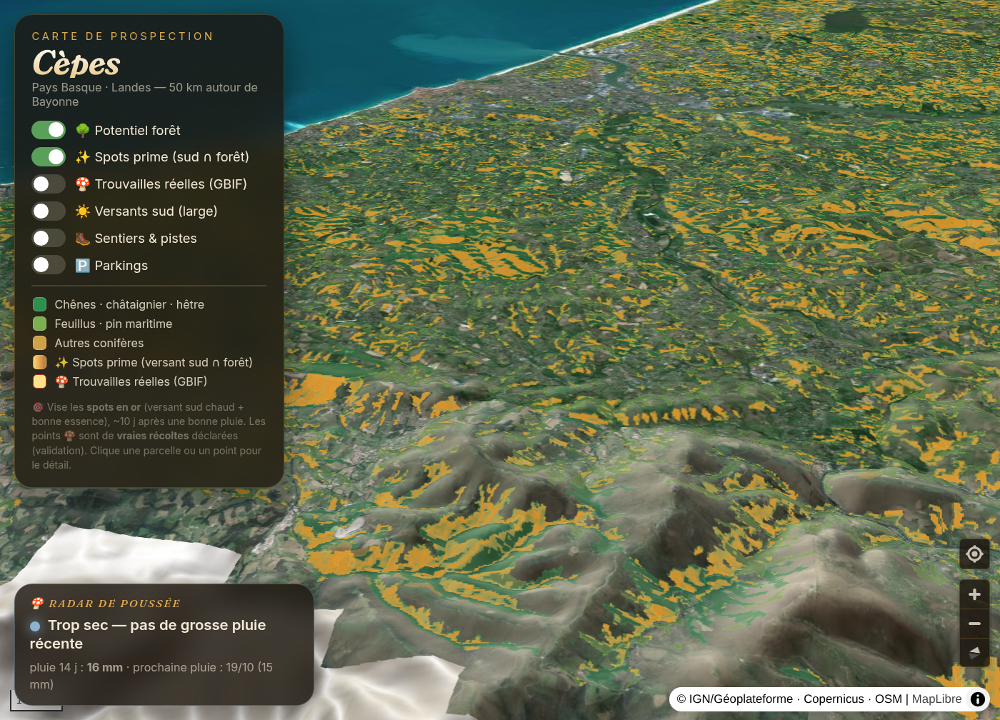

# 🍄 Carte à cèpes — Pays Basque & Landes

Carte de prospection **data-driven** pour la cueillette des cèpes/bolets autour de Bayonne : on croise **essences forestières**, **exposition/pente du relief**, **observations réelles** et **météo** pour repérer les meilleurs coins — *la science, pas la chance*.

**🔗 Live : [cepes.tbrun.dev](https://cepes.tbrun.dev)** · relief 3D, mobile-friendly, géolocalisation.



## Idée

Le cèpe (tête de nègre *Boletus aereus*, cèpe de Bordeaux *B. edulis*, cèpe des pins *B. pinophilus*…) pousse selon des facteurs **prévisibles** : essence hôte, chaleur du versant, type de sol, et une **fenêtre météo** (~8-16 j après une bonne pluie si les températures restent douces). Plutôt que de tourner au hasard, cette carte combine ces couches pour prioriser la prospection.

## Couches

| Couche | Source | Rôle |
|---|---|---|
| 🌳 Potentiel forêt | BD Forêt V2 (IGN) | essence dominante scorée (chêne/châtaignier/hêtre = top) |
| ✨ Spots prime | DEM Copernicus + BD Forêt | **croisement** versant sud chaud + pente douce **∩** forêt favorable |
| ☀️ Versants sud (large) | DEM Copernicus GLO-30 | exposition sud × pente 5-20° (GDAL `aspect`/`slope`) |
| 🧬 Essences 10 m | ForestPaths (Sentinel-1/2) | genre d'arbre à 10 m (chêne/hêtre/pin…) pour affiner |
| 🍄 Trouvailles réelles | GBIF | occurrences de *Boletus* (validation terrain) |
| 🥾 Sentiers & 🅿️ parkings | OpenStreetMap | accès / planification |
| 🌦️ Radar de poussée | Open-Meteo | indice météo + alerte Discord quand la fenêtre s'ouvre |

Relief 3D : terrain [dem.tbrun.dev](https://dem.tbrun.dev) (Copernicus GLO-30, encodage *terrarium*).

## Pipeline

Tout est reconstructible via les scripts (les données générées ne sont pas versionnées) :

```bash
python3 build_cepes.py     # BD Forêt WFS → foret.geojson (⚠ BBOX en CRS:84 lon,lat)
                           #   puis: tippecanoe -o foret.pmtiles ...
python3 build_aspect.py    # DEM → expo sud × pente (⚠ gdaldem slope -s 111120 en EPSG:4326)
python3 build_prime.py     # croisement strict sud ∩ forêt → tuiles "spots prime"
python3 build_osm.py       # Overpass → parkings.geojson + sentiers.pmtiles
python3 cepes_push.py      # radar météo Open-Meteo → push.json (+ alerte Discord)
```

Front : `index.html` (MapLibre GL + PMTiles + terrain 3D), servi en statique.

## Stack

MapLibre GL JS · PMTiles · tippecanoe · GDAL · Python · Open-Meteo · Overpass · GBIF · Caddy.

## Données & licences

- **BD Forêt V2**, **ORTHOPHOTOS**, **Copernicus GLO-30** via [IGN Géoplateforme](https://geoservices.ign.fr/) (licences ouvertes).
- **Carte d'essences 10 m** : *ForestPaths European Tree Genus Map* (Blickensdörfer et al.), **CC-BY-4.0** — [doi:10.5281/zenodo.13341103](https://doi.org/10.5281/zenodo.13341103).
- **OpenStreetMap** © contributeurs OSM (ODbL).
- **GBIF** occurrences (CC-BY / CC0 selon jeux).
- Météo : [Open-Meteo](https://open-meteo.com/) (CC-BY).

## ⚠️ Cueillette responsable

Carte d'**aide à la prospection**, pas une vérité de terrain. Respecte la réglementation : cueillette perso tolérée (souvent ~5 L/pers/jour, variable selon communes/ONF), **interdite en forêt privée sans accord**, laisse les jeunes et les vieux, ne retourne pas la litière. Les points GBIF sont des observations publiques, pas des coins personnels.

---

*Projet perso — Thibault Brun, Bayonne.*
